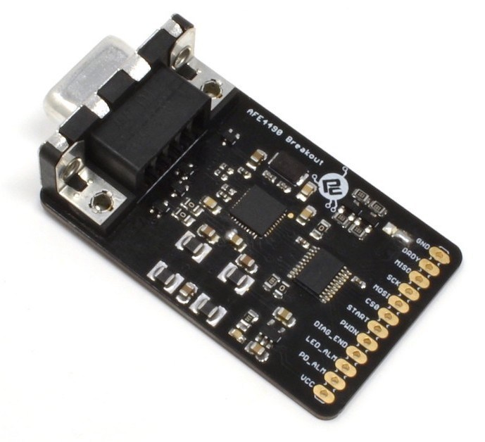

# ProtoCentral AFE4490 Pulse Oximeter Arduino Library

[](https://github.com/Protocentral/protocentral-afe4490-arduino/actions/workflows/arduino-lint.yml)
[](https://github.com/Protocentral/protocentral-afe4490-arduino/actions/workflows/compile-examples.yml)

Arduino library for the **ProtoCentral AFE4490 Pulse Oximeter Breakout** and **AFE4490 Shield**, and for the AFE4400 on **Sensything OX**. It reads red, IR and ambient PPG from the TI AFE4490 / AFE4400 analog front end, and its SpO2 and heart-rate algorithms run on an Arduino Uno.

## Don't have one? [Buy the breakout](https://protocentral.com/product/protocentral-afe4490-pulse-oximeter-breakout-board-kit/) or [the shield](https://protocentral.com/product/protocentral-afe4490-pulse-oximeter-shield-for-arduino-v2/)



## Links

| | |
|---|---|
| 🛒 Breakout product page | https://protocentral.com/product/protocentral-afe4490-pulse-oximeter-breakout-board-kit/ |
| 🛒 Shield for Arduino | https://protocentral.com/product/protocentral-afe4490-pulse-oximeter-shield-for-arduino-v2/ |
| 📖 Getting started guide | https://docs.protocentral.com/getting-started-with-AFE4490/ |
| 🔧 Breakout v2 design files | [`hardware/`](hardware/) |
| 📈 OpenView companion app | https://github.com/Protocentral/protocentral_openview |
| 📄 AFE4490 datasheet (TI SBAS602) | https://www.ti.com/lit/ds/symlink/afe4490.pdf |
| 📄 AFE4400 datasheet (TI SBAS601) | https://www.ti.com/lit/ds/symlink/afe4400.pdf |

## How it works

A pulse oximeter shines red and infrared light through a fingertip and measures what comes out. Blood absorbs more light at every heartbeat, so the light level ripples by 0.5-5 %. Oxygenated and deoxygenated haemoglobin absorb red and IR differently. The ratio of the red ripple to the IR ripple, each relative to its steady level, therefore gives the oxygen saturation (SpO2), and the ripple period gives the heart rate.

The AFE4490 does the analog part. In each **pulse repetition period** (the PRF, default 500 Hz) it runs four phases:

| Phase | What happens |
|---|---|
| LED2 (red) | Red LED on, photodiode current sampled |
| Ambient 2 | Both LEDs off, ambient light sampled |
| LED1 (IR) | IR LED on, photodiode current sampled |
| Ambient 1 | Both LEDs off, ambient light sampled |

A transimpedance amplifier converts the photodiode current to a voltage, and a 22-bit ADC converts each phase. The chip also subtracts the ambient from each LED value. When all six results are ready it pulses **ADC_RDY (DRDY)**, and the library reads them on that interrupt.

The optional `AFE44xx_Algorithms` class turns the samples into SpO2 and heart rate:
- it low-pass filters and resamples any input rate of at least 50 Hz to 50 Hz, so the results do not depend on the PRF
- it detects each beat on the ambient-subtracted IR signal
- it computes the red / IR ratio of every beat as a least-squares fit over all of the beat's samples, then takes the median over 5 beats
- it reports results as invalid until it has 4 regular beats of good signal

The processing uses about 150 bytes of RAM.

## Hardware

| Board | Chip | Host connection | Notes |
|---|---|---|---|
| **AFE4490 Breakout v2** | AFE4490 | 0.1" header: SPI, DRDY, PWDN, START (= RESET), DIAG_END, LED_ALM, PD_ALM, VCC, GND | On-board level shifter; DB9 for Nellcor-compatible probes. Design files in [`hardware/`](hardware/) |
| **AFE4490 Shield** | AFE4490 | Plugs onto an Arduino Uno (D2, D4, D7, SPI) | Same pins as the examples' defaults |
| **Sensything OX** | AFE4400 | ESP32-S3, on board | Use `cfg.chip = AFE44xx_Chip::AFE4400`; driven by SensythingCore |

The AFE4400 shares the AFE4490's register map but not every bit. It has a fixed 50 mA LED full scale, no separate LED1 gain, no filter-corner select and no TX reference select. Neither chip has an ID register, so tell the driver which one it is driving.

## Features

- **Red, IR and ambient PPG**
  - PRF 63 Hz to 5 kHz, LED duty cycle 1-25 %
  - 1-16 ADC averages per phase
  - all six result registers per sample, including the ambient-subtracted ones
- **Transmitter:** 8-bit LED current per LED, LED range and TX reference (AFE4490), H-bridge or push-pull drive
- **Receiver:**
  - TIA feedback resistor (10 kΩ to 1 MΩ) and capacitor (5 to 250 pF)
  - stage 2 gain ×1 to ×4
  - separate LED1 gain (AFE4490)
  - ambient cancellation DAC 0-10 µA
  - 500 Hz / 1 kHz filter corner (AFE4490)
- **SpO2, heart rate (30-230 bpm), perfusion index and signal quality** with the optional algorithms
  - works at any PRF
  - about 150 B RAM, fits on an Arduino Uno
- **Diagnostics:** LED open / short and photodiode open / short checks
- **Data-ready handling:**
  - **interrupt-driven**, with a missed-sample counter
  - timed reads when there is no interrupt pin, or when the DRDY line fails
- **Shared-bus safe:** SPI transactions on any `SPIClass`; settings can change while running; every register write is verified by read-back
- **1.x API kept:** existing sketches build unchanged
- **Standalone:** `depends=` is empty
- **Host boards:** Uno, Nano, Mega, Leonardo, Uno R4, Nano 33 BLE, nRF52840, ESP32, ESP32-S3, ESP32-C3 and RP2040

## Safety

> **Not a medical device. For research and education only.**
>
> The SpO2 calibration curve has not been validated for any particular probe. Do not use the readings for diagnosis or treatment.

## Installation

### Arduino Library Manager (Recommended)

1. Open **Sketch → Include Library → Manage Libraries…**
2. Search for **ProtoCentral AFE4490**.
3. Install **ProtoCentral AFE4490 PPG and SpO2 boards library**.

### Manual Installation

Download this repository as a ZIP, then use **Sketch → Include Library → Add .ZIP Library…**

## Hardware Setup

**Shield:** stack it on the Arduino. It uses the pins below and the ICSP header for SPI, so it also works on boards where SPI is only on ICSP.

**Breakout:**

| Breakout pin | Function | Arduino Uno | ESP32 DevKit |
|---|---|---|---|
| GND      | Ground | GND | GND |
| DRDY     | ADC_RDY, data ready (interrupt) | **D2** | GPIO26 |
| MISO     | SPI data out | D12 | GPIO19 |
| SCK      | SPI clock | D13 | GPIO18 |
| MOSI     | SPI data in | D11 | GPIO23 |
| CS0      | SPI chip select | D7 | GPIO13 |
| START    | Wired to the AFE's **RESET** (active low) | D5 | GPIO14 |
| PWDN     | AFE_PDN, power-down (active low) | D4 | GPIO27 |
| DIAG_END | Diagnostics done (optional) | - | - |
| LED_ALM  | LED fault (optional) | - | - |
| PD_ALM   | Photodiode fault (optional) | - | - |
| VCC      | Supply | 5V | 5V |

**Pin notes**
- **DRDY:** wire it to get every sample. It must go to an interrupt-capable pin (D2 or D3 on an Uno). Without it the library reads on a timer, which works, but samples can be read while the chip is updating them.
- **START / RESET and PWDN:** pass `-1` to the constructor for either one if it is not wired. Without RESET the library uses the software reset. Do not leave a wired pin undriven.

Plug a Nellcor-compatible SpO2 finger probe into the DB9 connector.

## Quick Start

```cpp
#include <SPI.h>
#include "protocentral_afe44xx.h"

Protocentral_AFE44xx afe(7 /*CS*/, 2 /*DRDY*/, 4 /*PWDN*/, 5 /*RESET*/);

void setup() {
    Serial.begin(115200);
    if (!afe.begin()) {                 // reset, check SPI, start at 500 Hz
        Serial.println("AFE4490 not found");
        while (1);
    }
    afe.enableDataReadyInterrupt();     // one read per sample
}

void loop() {
    AFE44xx_Sample s;
    if (afe.available() && afe.read(s)) {
        Serial.print(s.ir());           // ambient-subtracted IR, signed 22-bit counts
        Serial.print(' ');
        Serial.println(s.red());        // ambient-subtracted red
    }
}
```

### SpO2 and heart rate

```cpp
AFE44xx_Algorithms algo;                // in setup(): algo.begin(afe.getSampleRate());

algo.processSample(s.ir(), s.red());    // every sample, at any PRF >= 50 Hz
algo.spo2();                            // %, 0 while invalid
algo.heartRate();                       // bpm, 0 while invalid
algo.spo2Valid();                       // true after ~4 regular beats of good signal
algo.signalQuality();                   // AFE44XX_QUALITY_* flags, 0 = good
```

### Custom configuration

`begin()` with no arguments applies the same register profile as 1.x:
- 500 Hz PRF, 25 % duty cycle, 8 averages
- both LEDs at DAC code 20 (11.7 mA on the AFE4490)
- TIA 250 kΩ / 5 pF, stage 2 off, no ambient DAC

To change it, pass an `AFE44xx_Config`. Every setter below also works at any time while running.

```cpp
AFE44xx_Config cfg;
cfg.prf         = 1000;                 // Hz; averages are reduced to what fits
cfg.led1Current = 40;                   // IR, DAC code 0-255
cfg.tiaRf       = AFE44xx_TiaRf::RF_500K;
afe.begin(cfg);

afe.setLedCurrent(AFE44xx_Led::Red, 32);
```

For Sensything OX, set `cfg.chip = AFE44xx_Chip::AFE4400`.

### Using a different SPI bus or pins

```cpp
Protocentral_AFE44xx afe(CS, DRDY, PWDN, RESET, SPI1);   // any SPIClass
afe.begin(sck, miso, mosi, cfg);                          // ESP32 only: custom SPI pins
```

## API Reference

### Constructor and lifecycle

| Method | Description |
|---|---|
| `Protocentral_AFE44xx(cs, drdy = -1, pdn = -1, reset = -1, SPIClass& spi = SPI)` | `-1` = pin not wired |
| `bool begin(bool startSPI = true)` | Reset, check SPI read-back, apply the default profile, start |
| `bool begin(const AFE44xx_Config&, bool startSPI = true)` | Same, with a custom configuration |
| `bool begin(sck, miso, mosi, config)` | ESP32 only: custom SPI pins |
| `void end()` | Stop, power down, release the interrupt |
| `AFE44xx_Status lastError()` | `Ok`, `SpiError`, `VerifyFailed`, `InvalidArgument`, `Unsupported`, `NotInterruptPin`, ... |
| `bool isConnected()` | An AFE44xx answers on SPI (there is no ID register) |
| `bool isSettled()` | `AFE44XX_SETTLE_MS` (1 s) have passed since `begin()`, so data are high-accuracy |
| `config()` / `getLibraryVersion()` | Current configuration / library version string |

### Reading data

| Method | Description |
|---|---|
| `bool available()` | A new sample is ready |
| `bool read(AFE44xx_Sample&)` | `led1`, `led2`, `aled1`, `aled2`, `led1MinusAled1`, `led2MinusAled2` (signed 22-bit counts), `sequence`; `ir()` / `red()` |
| `bool readLatest(AFE44xx_Sample&)` | Read now, without waiting for data ready |
| `enableDataReadyInterrupt()` / `disableDataReadyInterrupt()` | Catch ADC_RDY with a RISING interrupt |
| `uint32_t missedSamples()` | Samples that arrived before the previous one was read |
| `bool dataReadyPinFault()` | The interrupt stopped firing; the driver now reads on a timer |

### Timing, power and front end

| Method | Description |
|---|---|
| `start()` / `stop()` / `standby()` / `wakeup()` | Timing engine and power |
| `setPRF(hz)` / `getSampleRate()` | 63-5000 Hz; samples per second = PRF |
| `setDutyCycle(percent)` | LED on-time, 1-25 % |
| `setAverages(n)` / `getAverages()` / `maxAverages(prf)` | ADC averages per phase, up to 16 and up to what fits at the PRF |
| `setLedCurrent(led, code)` / `getLedCurrent(led)` | 8-bit DAC code: current = code / 256 × `ledFullScaleMilliamps()` |
| `setLedRange(AFE44xx_LedRange)` | `Full`, `Half` (AFE4490), `Off` |
| `setTxReference(AFE44xx_TxRef)` | AFE4490: `V0_75`, `V0_5`, `V1_0` |
| `setReceiverGain(rf, cf, stage2)` | TIA RF / CF and stage 2 gain for both LEDs |
| `setLed1ReceiverGain(enable, rf, cf, stage2)` | AFE4490: separate LED1 gain |
| `setAmbientDac(uA)` / `setFilterCorner1kHz(bool)` | Ambient cancellation 0-10 µA / 1 kHz filter (AFE4490) |
| `runDiagnostics(AFE44xx_Diagnostics&)` | LED and photodiode open / short flags (`AFE44XX_DIAG_*`), ~50 ms |
| `readRegister(reg)` / `writeRegister(reg, value)` / `printRegisters(Stream&)` | Raw register access; writes are masked for the chip and verified |

LEDs are `AFE44xx_Led::LED1` / `LED2`, also available as `IR` / `Red`.

### `AFE44xx_Algorithms`

| Method | Description |
|---|---|
| `bool begin(sampleRate)` | Reset. Returns false below 50 Hz |
| `reset()` | Clear all state |
| `bool processSample(ir, red)` | Feed every sample at the `begin()` rate; true when a beat updated the results |
| `bool processSampleTimed(ir, red, intervalUs)` | For callers without a fixed rate |
| `spo2()` / `heartRate()` | %, bpm; 0 while invalid |
| `spo2Valid()` / `heartRateValid()` | Validity |
| `signalQuality()` | `AFE44XX_QUALITY_NO_SIGNAL`, `SATURATED`, `LOW_PERFUSION`, `NO_PULSE`, `RATE_TOO_LOW`; 0 = good |
| `perfusionIndex()` / `ratio()` / `filteredIr()` | IR AC/DC in 0.01 %, median R × 1000, band-passed IR at 50 Hz |

The SpO2 curve is `AFE44XX_SPO2_A × R² + AFE44XX_SPO2_B × R + AFE44XX_SPO2_C`. To use your own calibration, define these before the include.

## Examples

| # | Sketch | Description |
|---|---|---|
| 01 | `01.SerialPlotter` | IR and red PPG in the Arduino Serial Plotter |
| 02 | `02.OpenView` | Stream red, IR, heart rate and SpO2 to OpenView |
| 03 | `03.SpO2HeartRate` | SpO2, heart rate, perfusion index and signal quality once per second |
| 04 | `04.HighRateInterrupt` | 1 kHz on an interrupt, with received / missed counts |
| 05 | `05.Diagnostics` | Version, register dump, probe fault check and data-path check. Run this first if something is wrong |
| 06 | `06.CustomConfig` | Custom configuration and run-time LED current adjustment |
| 07 | `07.LegacyPolling` | The 1.x API, unchanged |

All examples print at **115200 baud**, except 02, which streams binary packets at **57600 baud**.

## Streaming to OpenView

1. Upload `02.OpenView`.
2. Open [ProtoCentral OpenView](https://github.com/Protocentral/protocentral_openview).
3. Select the **AFE4490 Breakout** board, then pick the serial port.


The sketch sends 100 packets per second at 57600 baud. Each packet is `0x0A 0xFA 0x0A 0x00 0x02`, then a 10-byte payload, then `0x00 0x0B`. The payload is red `int32`, IR `int32`, heart rate `uint8`, SpO2 `uint8`, little-endian, with 0 for invalid values.

This layout is shared with OpenView's `afe4490` board descriptor. The sketch prints nothing else, because any text would corrupt the stream.

## Troubleshooting

**`begin()` fails with `SpiError`**
- Check the CS/SCK/MOSI/MISO wiring and VCC/GND.
- PWDN must not be held low.

**`begin()` fails with `VerifyFailed`**
- Registers are not reading back correctly. Shorten the wires, or define `AFE44XX_SPI_CLOCK 1000000` before the include.

**`dataReadyPinFault()` is true, or `05.Diagnostics` says DRDY never fired**
- Check the DRDY wire. On an Uno it must go to D2 or D3.

**Diagnostics report "photodiode open" or "LED open"**
- The probe is unplugged or damaged.

**`signalQuality()` says no finger**
- The IR level is too low. Check the probe and the finger position, or raise the LED current.

**`signalQuality()` says saturated**
- Lower the LED current, or the TIA gain (`RF_250K` → `RF_100K`).

**SpO2 / heart rate stay 0**
- They need about 5 s of a still finger and a regular pulse.
- A weak pulse (`LOW_PERFUSION`) blocks SpO2 but not heart rate. Warm the finger or raise the LED current.

## Migrating from 1.x

1.x sketches build and run unchanged (see `07.LegacyPolling`). Two things behave differently:
- `get_AFE44XX_Data()` now gives correct SpO2 and heart rate at any call rate of at least 50 Hz, and it sets `buffer_count_overflow` at every beat instead of every 4 s.
- The unprefixed register macros (`CONTROL0`, `LED1VAL`, …) are gone. Use `AFE44XX_REG_CONTROL0`, `AFE44XX_REG_LED1VAL`, …

To use the new API:

| 1.x | 2.0 |
|---|---|
| `AFE44XX afe44xx(CS, PWDN);` | `Protocentral_AFE44xx afe(CS, DRDY, PWDN, RESET);` |
| `SPI.begin(); afe44xx.afe44xx_init();` | `afe.begin();`, which returns `bool`, then `afe.enableDataReadyInterrupt();` |
| `delay(8); afe44xx.get_AFE44XX_Data(&data);` | `if (afe.available() && afe.read(s))` |
| `data.IR_data` / `data.RED_data` | `s.led1` / `s.led2`, or the ambient-subtracted `s.ir()` / `s.red()` |
| `data.spo2`, `-999` when invalid | `algo.spo2()`, with `algo.spo2Valid()` |
| `data.heart_rate` | `algo.heartRate()`, with `algo.heartRateValid()` |
| `data.buffer_count_overflow` | the return value of `algo.processSample()` |

See [CHANGELOG.md](CHANGELOG.md) for details.

## License

- **Software:** MIT
- **Hardware:** CERN-OHL-P v2
- **Documentation:** CC BY-SA 4.0

See [LICENSE.md](LICENSE.md).

Copyright (c) 2018-2026 ProtoCentral Electronics.

## Support

Open an issue on [GitHub](https://github.com/Protocentral/protocentral-afe4490-arduino/issues) or email support@protocentral.com.
